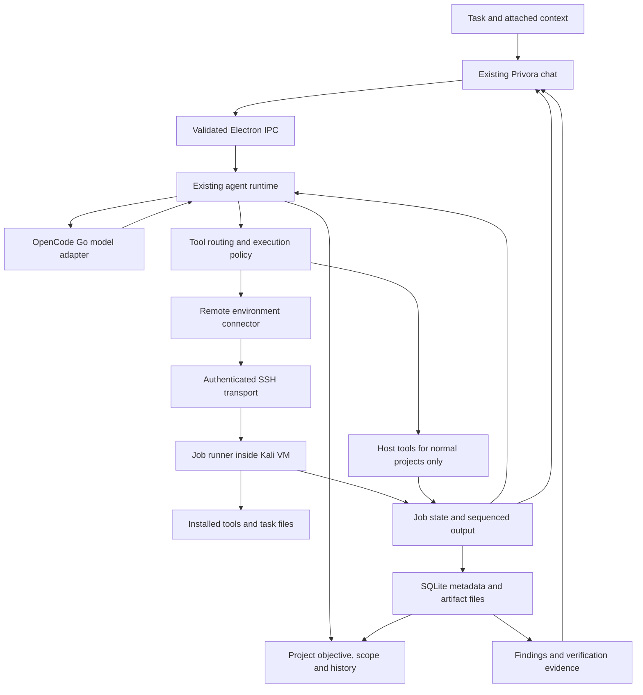

# Security workspace architecture

Status: SSH connector/runner, explicit Security workspaces, agent tool routing,
durable jobs/findings, and chat evidence UI are implemented in source. Packaged
end-to-end acceptance verification is in progress.

## Existing foundation

Privora Desktop uses Electron, React, TypeScript, Vite and Electron Forge.
SQLite metadata and artifact files provide local persistence. The main process
owns agent execution and tools; the context-isolated preload exposes validated
IPC to the renderer. Existing modules include turn coordination, provider
streaming, terminal sessions, browser/computer tools, approvals and recovery.

The first implementation keeps those boundaries. No separate provider loop is
introduced for Security workspaces. Rust is optional future work for a measured
bottleneck or a specific native capability.

## Implemented topology

Future adapters may connect Windows test environments, browsers inside the test
environment, Android devices/emulators and dedicated Linux machines. Local
Privora browser/computer tools operate on the host today: do not silently treat
them as remote VM tools.

## Agent behavior

Loop: understand objective → discover capabilities → plan → execute → inspect
evidence → adjust → verify → report.

The prompt is assembled from base Privora instructions, Security workspace
instructions, current environment capabilities and optional specialist roles.
The model proposes actions; execution policy enforces their allowed environment
and permissions. Plan Mode remains non-mutating.

The user selects the main model and reasoning level through existing controls.
Specialists use the existing delegation mechanism; no automatic three-model
routing policy is introduced. Delegation is optional. Privora's existing Reviewer
Swarm remains a distinct feature, not a new security-specific agent mode.

Reuse the existing OpenCode Go adapter. Verify exact model IDs, tool support,
routes and reasoning levels before exposing defaults. Never infer every model's
capabilities from its family name or force unsupported `none` reasoning.

## Environment boundary

Every execution job identifies its environment. Security work initially uses
the selected remote environment; there is no automatic fallback to local Windows
execution. Local attachment import, artifact preview and metadata storage remain
explicit app operations. Model-facing local file/terminal/browser/computer access
must follow declared permissions independently of remote access.

Use SSH with pinned/verified host identity and protected credential references.
Do not expose the runner publicly or disable host verification. Start with one
environment and one transport, avoiding a general plugin platform initially.

The Kali VM has no default shares of personal host folders. Transfer approved
project files into a project-specific directory. Use a regular execution user;
privileged setup is separate. Bound jobs, process output, disk use and duration.
Network egress restrictions must be enforced outside untrusted job control where
practical. NAT, a prompt, or a hostname allowlist alone is not scope enforcement.
Account for redirects, DNS changes, IPv6 and infrastructure dependencies in the
scope design before promising network containment.

Remote tool output, filenames and documents are untrusted data. They cannot
authorize commands, expand scope or change application permissions. Redact secrets
before logs and model context; keep API credentials on Privora's side.

## Runner and connector contracts

The desktop connector uses TypeScript and the system OpenSSH client. The first
runner uses Python 3 standard-library modules already available in the supplied
Kali VM; Node installation is not required. Deploy it into a content-hashed
version directory so running workers retain the code version they started with.
Protocol v1 uses JSON over SSH stdin/stdout, with an explicit version handshake.
No additional network listener or model credentials are installed on Kali.

Implemented interfaces are in src/shared/kali.ts and src/main/kali/connector.ts.
KaliEnvironment is main-process configuration containing endpoint, key-file and
single-host pin-file references, expected ED25519 fingerprint, runner path and job
root. It contains no private key material. No user-specific profile is committed.
Main-process configuration persistence and renderer IPC are implemented.
Renderer summaries exclude identity-file paths, pin-file paths, and private
configuration. Profile import and connection checks are explicit user actions.

Minimum operations:

- Discover tools, OS/architecture and supported execution capabilities.
- Submit a job with a client-generated idempotency key, argv, cwd and timeout.
- Inspect job state and read output after a sequence cursor.
- Cancel the process group and report confirmed termination.
- Transfer and retrieve bounded artifacts within the project directory.

The first runner executes argv without implicit shell wrapping. An explicitly
requested shell executable is still a shell operation and must receive the
appropriate permission checks through Security tool routing. Validate
paths against traversal and symlink escape. An SSH disconnect is not proof that
a process stopped. Retain job IDs and reconnect for state reconciliation. Decide
per job whether it survives transport loss; show unknown state until confirmed.
Never automatically replay a possibly mutating job after uncertain delivery.

Job states: queued, running, stop_requested, succeeded, failed, cancelled,
timed_out. Environment connectivity and unknown job state are separate fields.
Persist ordered events for reconnect; live delivery alone is not the source of truth.

The runner persists job metadata and bounded output in a private SQLite database
under jobRoot/.privora. Project working directories are jobRoot/workspaces/<id>.
Limits are four concurrent jobs, one-hour maximum job duration, 8 MiB retained
output per job, 1 MiB per artifact transfer and 128 KiB control requests. Output
events carry sequenced base64 bytes for incremental per-stream UTF-8 decoding.
Artifact reads reject traversal, symlinks, special files and oversized transfers.

Cancellation terminates the supervised process group and escalates to SIGKILL.
This is process supervision, not a per-job OS sandbox: a hostile process may
escape its process group, and argv execution has the remote user's OS access.
The VM remains the host-isolation boundary. Disk quotas, cgroup containment,
network scope enforcement and privilege policies are not implemented in v1.

## Persisted integration records

| Record | Core fields |
| --- | --- |
| Workspace | id, type: development/security, name |
| Project context | environmentId, objective, scope in the Security workspace configuration |
| Environment | id, name, endpoint, connection state, checked time, capabilities; private SSH configuration stays in main |
| Run | Existing thread, assistant message, provider settings, checkpoint and tool-event records |
| Job | local/remote IDs, workspace/thread/message, environment, idempotency key, state, exit code, redacted bounded previews |
| Output | Runner-persisted sequenced output; desktop cursor and bounded preview |
| Artifact | Existing DesktopAttachmentRecord identity, MIME type, size, app-owned URL; referenced by job |
| Finding | workspaceId, title, description, severity, state, evidenceJobIds, reproduction, remediation |

Workspace type is optional for backward compatibility: existing projects remain
Development. Security metadata reuses existing SQLite/artifact storage. Large
output stays bounded in renderer snapshots; jobs survive app-side reconnect and
are reconciled by their persisted identity rather than automatically resubmitted.

Implemented finding states: candidate, observed, verified, rejected, stale.
Verified findings require reproduction and completed evidence jobs from this
workspace. This validates evidence references, not the truth of an AI assertion;
tool exit success alone does not establish a vulnerability. Independent retest,
report generation, and stronger verification workflows remain future work.
