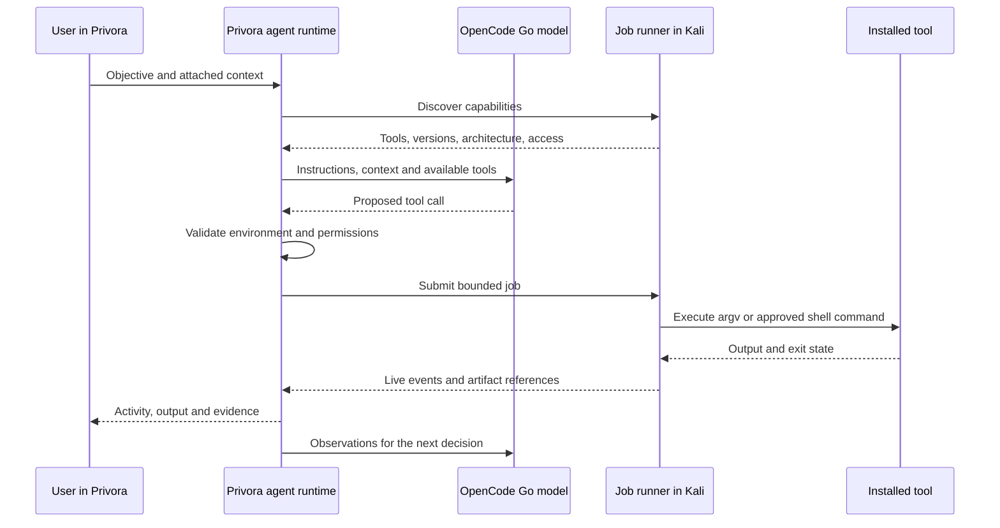

# Kali tool operations and expert workflow

Status: the operator's Kali ARM64 VM is reachable by verified key-based SSH.
The Python job runner has been deployed and tested. Security workspace/model tool
integration, findings, and evidence UI are implemented in source; packaged
assessment acceptance is in progress. Task-specific packages are installed only
when needed, not as a full-suite prerequisite.

## Where the agent lives

OpenCode Go is the hosted model provider, not a Kali utility or the Go programming
language. Privora's existing runtime calls it from the desktop main process. The
selected model proposes tool calls; Privora checks permissions and routes them.

Kali supplies an operating system and a selectable set of security packages. It
does not include our Privora agent or job runner. Install the versioned runner
separately when implementation and environment setup are authorized. It receives
jobs through the SSH connector, executes tools and returns sequenced events.
The model API key stays in Privora. No second reasoning agent is required in Kali.

## Tool inventory and installation

Discover installed executable paths and versions before work. Record required
privileges, output formats, ARM64 support, GUI/device dependencies and availability.
Run non-destructive readiness checks; do not discover tools by launching scans.

Kali metapackages vary by installation. `kali-linux-headless` covers a default
non-GUI tool selection; `kali-linux-default` is the default desktop tool selection.
Do not assume either includes every needed package. Use individual packages or
task-relevant groups after checking dependency and disk impact; do not default
to `kali-linux-everything` on a 16 GB laptop.

Sources: [Kali metapackages](https://www.kali.org/docs/general-use/metapackages/),
[Kali tool documentation](https://www.kali.org/tools/).

Prefer official repositories and upstream documentation. When the operator has
authorized autonomous VM maintenance, install task-relevant packages without
repeated approval prompts, after checking dependencies and storage impact. Verify
actual sudo privileges; Privora Full access alone does not grant root. The operator
may explicitly enable passwordless sudo inside the isolated guest. Authentication
passwords and model credentials must not be embedded in chat or job commands.

Use `pipx` or dedicated virtual environments for Python applications on Kali;
`pip --user` can be rejected by externally managed system Python. Check ARM64
support before downloading binaries. Go can also be installed in a user-local
directory when system packages are unavailable. Confirm each real installation
using executable/version checks: `apt-get -s` only simulates package changes.

For HTTP JSON sources, check status and content type and preserve a bounded
error-body/stderr preview before parsing. Empty or malformed responses are tool
failures, not proof that no results exist. Reconcile an uncertain runner job before
repeating its command.

Refresh and test the environment before a run, then record versions. Avoid
upgrading the rolling distribution mid-assessment. Snapshot after verified setup
and retain the package/version manifest for reproduction.
Source: [Updating Kali](https://www.kali.org/docs/general-use/updating-kali/).

## How the agent should work

1. Establish the question, authorized scope, permitted actions and evidence needed
   to answer it. Ask only for missing information that materially affects execution.
2. Inspect existing evidence, environment readiness and architecture limitations.
3. Form a small number of testable hypotheses; choose the lowest-impact check that
   distinguishes them. Do not equate running many scanners with thorough testing.
4. Execute with explicit cwd, bounded time/output and appropriate permissions.
   Prefer structured argv and machine-readable output when the tool supports it.
5. Inspect exit code and output. Separate a tool error from a negative finding;
   validate that the intended check actually ran.
6. Corroborate important signals with an independent method or reproducible check.
   Preserve raw evidence and record commands, versions and environment identity.
7. Update findings and remaining tasks. Stop when the objective is supported by
   evidence, blocked by missing access, or the budget is exhausted.
8. Report confirmed results, limitations, reproduction and suggested fixes.
   Retest relevant behavior after changes rather than repeat the entire assessment.

No prompt can guarantee senior-level expertise. Evaluate this behavior using
known lab cases, false-positive checks and reproducibility before making claims.

## Terminal, browser and device behavior

Current remote CLI jobs use captured stdout/stderr, bounded retained output,
timeouts, and process-group cancellation. Managed remote PTY/stdin interaction is
not implemented. Interactive tools require a future adapter; do not pretend a
noninteractive job supplies terminal interaction or desktop control.

Security chats expose `kali_exec` and the other `kali_*` tools. The ordinary local
terminal documentation describes `exec_command`; that host tool is not exposed
in Security projects. Windows workspace paths do not exist in the guest. File
upload/transfer and remote GUI connectors remain separate work; only files already
in the Kali project can currently be retrieved as evidence.

GUI applications require a distinct remote desktop/browser adapter. SSH execution
does not provide computer vision or mouse control. Device, USB and wireless tools
require corresponding hardware access; ARM64 compatibility remains tool-specific.

Privora shows compact live job rows and expandable output in the existing chat.
Reasoning summaries may be shown when provided, but never invent hidden model
thoughts. Remote connection loss becomes unknown state until reconciled; it does
not trigger fallback to the Windows terminal.

## Practical first proof

Connect to Kali, discover a small tool inventory, run a harmless diagnostic,
stream output, cancel an interactive test process and retrieve a sample artifact.
Then perform a static analysis of an owned sample file with known expected results.
No production target or full-tool-suite installation is needed for this proof.
